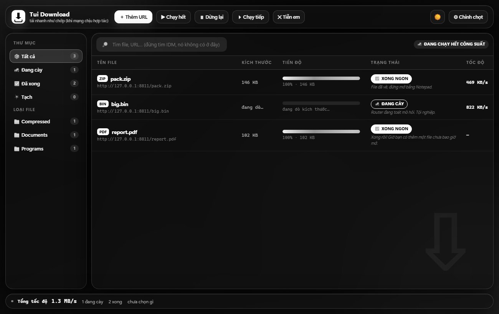

# Tui Tải (tuitai)

Trình quản lý tải xuống viết bằng **Go**, chạy trên **Windows · macOS · Linux**.
Có giao diện kiểu IDM (glassmorphism, Light/Dark), tải đa kết nối, resume, hàng
đợi, bắt link, tải HLS, và hơi lắm lời.

[](https://github.com/captajn/tuitai/actions/workflows/ci.yml)
[](https://github.com/captajn/tuitai/actions/workflows/build-windows.yml)
[](https://github.com/captajn/tuitai/actions/workflows/release.yml)



## Tính năng

| Nhóm | Chi tiết |
|------|----------|
| Tốc độ | 1–32 kết nối HTTP Range, ghi song song theo offset, luồng nhanh "lấy" đuôi luồng chậm |
| Bền | Resume theo ETag/Last-Modified, file `.part`, checksum sha256/md5, đổi tên khi xong |
| Hàng đợi | Ưu tiên, giới hạn job đồng thời, pause/resume/xoá, retry backoff, mirror |
| Hẹn giờ | Khung giờ tải (`schedule`), `--at HH:MM` cho từng job, giới hạn tốc độ off-peak |
| Phân loại | Tự xếp `Video/ Music/ Documents/ Compressed/ Programs/ Images/` |
| Bắt link | `tuitai grab <trang>` rút link file/media/HLS; `tuitai import <file|->` |
| HLS | Tải playlist `.m3u8` (kể cả `EXT-X-MAP`), ghép nhị phân hoặc remux bằng ffmpeg |
| Giao diện | GUI kiểu IDM: Light = trắng + xanh lá, Dark = trắng đen; TUI + CLI đầy đủ |
| Trình duyệt | Daemon 127.0.0.1 + extension Chrome MV3 (menu chuột phải, quét link trang) |
| Khác | Kiểm dung lượng trống, thông báo hoàn tất, `doctor`, xuất CSV, theo dõi clipboard |

## Cài đặt

### Dùng bản phát hành

Tải ở [Releases](https://github.com/captajn/tuitai/releases):

| Bản | File | Ghi chú |
|-----|------|---------|
| **Windows setup** | `tuitai-setup-vX-x64.exe` | Cài vào Program Files, có lối tắt, tự xuất extension |
| **Windows portable** | `tuitai-windows-amd64.exe` | Chạy ngay, không cài đặt (đổi tên tuỳ thích) |
| Windows ARM64 | `tuitai-windows-arm64.exe` | Máy Snapdragon/ARM |
| **macOS** | `tuitai-darwin-arm64.app.tar.gz` | Giải nén ra `Tui Tai.app` (Apple Silicon) |
| macOS Intel | `tuitai-darwin-amd64.app.tar.gz` | |
| **Linux** | `tuitai-linux-amd64.tar.gz` | Kèm `tuitai.desktop` + icon |
| **Extension** | `tuitai-extension-mv3.zip` | Chrome/Edge: Load unpacked |

### Tự build

```bash
git clone https://github.com/captajn/tuitai
cd tuitai
go build -o tuitai ./cmd/tuitai     # Windows: -o tuitai.exe
./tuitai gui
```

Yêu cầu Go 1.27+. Không cần CGO, không cần thư viện ngoài (chỉ stdlib).

### Fork để tự build bản Windows

1. Fork repo này.
2. Vào tab **Actions** → chọn **build-windows** → **Run workflow** (nhánh `main`).
3. Khi chạy xong, tải `tuitai.exe` ở mục **Artifacts** của lần chạy đó.

Muốn ra bản Release có tag: **Actions → release → Run workflow**, nhập `v0.1.0`.
Workflow sẽ build 6 nền tảng, tạo Release kèm `SHA256SUMS.txt`.

## Dùng nhanh

```bash
tuitai gui                                   # mở giao diện (cổng 5566)
tuitai gui --tray --no-open                  # chạy nền + icon khay
tuitai autostart on                          # tự chạy khi khởi động máy
tuitai extension export                      # xuất extension MV3 ra đĩa
tuitai extension path                        # xem nơi đã xuất
tuitai add https://host/big.iso              # tải luôn
tuitai add https://host/big.iso --at 02:00   # hẹn 2h sáng
tuitai grab https://host/videos --ext mp4    # bắt link trên trang
tuitai hls https://host/live/master.m3u8     # tải + ghép HLS
tuitai import urls.txt                       # nhập danh sách
tuitai daemon --port 5555 --watch-clipboard  # nhận link từ extension + clipboard
tuitai doctor                                # kiểm tra môi trường
```

Xem đầy đủ: [docs/USAGE.md](docs/USAGE.md) · Tính năng so với IDM: [docs/FEATURES.md](docs/FEATURES.md) ·
Build & phát hành: [docs/BUILD.md](docs/BUILD.md) · Spec tạo ảnh/logo: [docs/ART-SPEC.md](docs/ART-SPEC.md).

## Cấu trúc

```
cmd/tuitai/        CLI, TUI, GUI (HTML nhúng), daemon
internal/
  probe/           dò HEAD/Range, tên file, MIME
  segments/        chia đoạn + cấp phát động
  downloader/      engine tải song song, resume, checksum
  queue/           hàng đợi + sự kiện
  limiter/         token bucket
  mirror/          xoay mirror
  state/           trạng thái resume
  verify/          checksum
  strutil/         tên file an toàn
  config/          cấu hình JSON
  category/        phân loại thư mục
  schedule/        khung giờ
  grab/            bắt link từ trang
  hls/             tải & ghép HLS
  notify/          thông báo hệ thống
  diskfree/        dung lượng trống
browser-extension/ Chrome MV3 gửi link sang daemon
assets/            logo, icon (xem docs/ART-SPEC.md)
```

## Giấy phép

MIT — xem [LICENSE](LICENSE).

> Tải nhanh hay chậm là do nhà mạng, tui chỉ là người đưa thư 🚚
